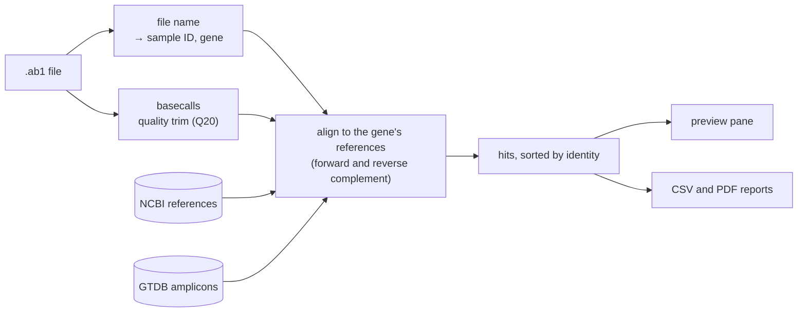

# The sequencing module: NCBI, GTDB and the previews

This fork of cosmic-files analyses Sanger reads (`.ab1` files). For each read it identifies the
closest species and, for some genes, predicts drug resistance. This document explains where the
reference sequences come from (**NCBI** and **GTDB**) and what each **preview pane** shows.

For how the module works, see [SEQUENCING_INTERNALS.md](SEQUENCING_INTERNALS.md) (pipeline, alignment, key
types) and [CACHE.md](../src/sequencing/CACHE.md) (caches). [NCBI.md](NCBI.md) explains the NCBI
databases and type material; [PREVIEWS.md](PREVIEWS.md) reviews the previews against the lab's
primers.

## 1. Overview



- **The file name selects the analysis.** `parse_ab1_filename`
  ([ab1_filename.rs](../src/sequencing/ab1_filename.rs)) is used by both the directory scan and
  the preview. A name without a recognised gene or primer keyword gets no analysis.
- **References are compiled into the binary.** Analysis needs no network access.
- **Identity** is matches ÷ aligned reference span. Hits below 80 % are not reported.

## 2. Reference sources

Every hit is tagged with its source (`RefSource::Ncbi` or `RefSource::Gtdb`). The two sources are
never merged: each is deduplicated, ranked, cut to its top 10 and turned into its own species call.

| | NCBI | GTDB |
|---|---|---|
| Content | Gene sequences from NCBI records and ntm-db genomes | In-silico PCR amplicons of GTDB species-representative genomes |
| Files | `res/sequences/myco_*.fasta`, `erm41/`, `pnca/` | `res/sequences/references/` |
| In git | `myco_*.fasta`: no (fetched at build time) | yes (committed) |
| Updated by | `build.rs` | `scripts/sync_cosmic_seq.py`, run by hand |
| Length | Mostly longer, partly full genes | Short, only the region between the primers |
| Used for | Species calls and resistance calls | Species calls |
| Taxonomy | Names as in the record; split genera such as *Mycobacteroides* occur | GTDB names; *Mycobacterium* includes *Mycobacteroides* and *Mycolicibacterium* |

### Which target uses which source

| Target | NCBI | GTDB amplicon files |
|---|---|---|
| 16S (5′ part) | `myco_rrs.fasta` | `16S_IMMF_IMMR2`, `16S_Mbak283f_Mbak259r`, `16S_Mbak283f_Mbak264r` |
| 16S 3′ end | `myco_rrs.fasta` | `16S_Bact1098s_Bact1525a` |
| rrs, Mtb complex (#289/#261) | `myco_rrs.fasta`; calls on the H37Rv rrs reference (`rrs/`) | `rrs_289_261` |
| rrl (23S) | `myco_rrl.fasta` | `23S_MCLR19F_MCLR21R` |
| rpoB, NTM region | `myco_rpob.fasta` (entries ≥ 400 bp) | `rpoB_2573f_3337r` (entries ≥ 400 bp) |
| rpoB, Mtb RRDR | none | `rpoB_TR1_TR2b` |
| rpoB, Mtb 5′ region | none | `rpoB_Tb176f_Tb176r` |
| rpoB, Mtb Xpert region | none | `rpoB_Xpert_F1_R`, `_F2_R`, `_F2_R2` |
| hsp65 | none | `hsp65_TB11_TB12` |
| erm(41) | three subspecies references (*abscessus*, *bolletii*, *massiliense*) | none |
| pncA | H37Rv, *M. bovis*, *M. canettii* | none |

`references/` holds more amplicon files than these. Only the files named in a `REF_AMPLICON_*`
constant in [mod.rs](../src/sequencing/mod.rs) are used. `myco_erm41.fasta` is generated but not
used.

### How the NCBI references are built

[build.rs](../build.rs) assembles them in three steps:

1. **Bulk queries** for each pooled gene, over Mycobacteriales. The rpoB, 16S and 23S queries are
   limited to type material and by sequence length.
2. **Single entries** listed in `res/sequences/sequences.toml`: a whole accession, a locus tag or
   a coordinate range. This provides the erm(41), pncA and H37Rv rpoB references, among others.
3. **ntm-db genomes**: genes are cut out of the genomes in the `res/sequences/ntm-db` git
   submodule, using their GFF annotation, and appended to the pooled files.

Things to know:

- The `NCBI_API_KEY` environment variable must be set, or the build stops.
- The submodule must be checked out (`git submodule update --init`).
- A file is downloaded only when it is missing or empty. After changing a query, delete the file
  and rebuild. Two machines can therefore hold different NCBI reference sets, depending on when
  each downloaded them.
- The build fails if `myco_rrl.fasta` or `myco_rrs.fasta` lacks an ntm-db entry for *M.
  abscessus*, *M. avium* or *M. intracellulare*.

### How the GTDB references are built

The [cosmic-seq](https://github.com/michaelmeuli/cosmic-seq) pipeline takes one representative
genome per GTDB species of the family Mycobacteriaceae (release r232), runs the lab's primer pairs
on each genome in silico (up to 3 mismatches per primer) and writes one FASTA file per amplicon.
It also writes `species_groups.tsv`, which maps species to complex names.

To bring a new export into this repository, do a dry run first:

```powershell
uv run --no-project python scripts/sync_cosmic_seq.py --dry-run --remote USER@cluster.s3it.uzh.ch:/shares/sander.imm.uzh/MM/kansasii/output/cosmic-seq/results/cosmic_files
```

Then run it again without `--dry-run` (or use `--from <dir>` for a local copy), rebuild, run
`cargo test -- sequencing`, review the diff and commit. Do not edit or copy these files by hand.
`references/MANIFEST.txt` records which cosmic-seq commit produced them.

### Why both are needed

- **Resistance calls need NCBI.** Catalogue positions refer to full-length ntm-db sequences
  (accession contains `:`). GTDB amplicons are too short and numbered differently. For rrl and
  rrs, `best_snp_hit` takes the species of the best NCBI hit and uses the best hit of that species
  that carries SNP calls.
- **Some species exist only in GTDB.** For *M. persicum*, *M. pseudokansasii*, *M. ostraviense*,
  *M. innocens* and *M. attenuatum*, the amplicons are the only references.
- **The two calls can differ**, because the reference sets and species boundaries differ. Both are
  shown; the module does not choose between them. Reports store them as `species` / `identity`
  (NCBI) and `species_gtdb` / `identity_gtdb`.

### Species names

How a species call is made from one source's hits:

| Target | Call |
|---|---|
| 16S | Hits within 0.1 % of the best are tied. Grouped species get the complex name (e.g. "M. kansasii complex"); other ties are joined ("Mycobacterium szulgai/malmoense"). |
| rpoB | Description of the best hit; no grouping. |
| 16S 3′ end | Only *M. marinum* or *M. ulcerans*; otherwise empty. |
| others | Description of the best hit. |

When two hits have equal identity, 16S, 16S 3′-end, rrl and rpoB rank the longer alignment first.

## 3. Previews

### Which preview is shown

With exactly **one** file selected, [app.rs](../src/app.rs) picks the first match below. The pane
code is in [item/sequencing.rs](../src/item/sequencing.rs). The keywords are a summary;
`gene_from_marker` has the exact rules.

| Order | Preview | Selected by (file name) |
|---|---|---|
| 1 | erm(41) | `erm`, `erm41…`, `ermprom`, `ermf…` / `ermr…` |
| 2 | hsp65 | `hsp65`, `65kDa`, `TB-11`, `TB-12` |
| 3 | rpoB | `rpo…`, `TR1` / `TR2b`, `81bp`, `Tb176` |
| 4 | 16S | `Mbak…` |
| 5 | rrs Mtb | `#289`, `#261`, or `rrs…` with 289 / 261 |
| 6 | 16S 3′ end | `1098s`, `1525a`, other `rrs…` |
| 7 | rrl | `rrl…`, `MCLR` / `MCRL`, `clr`, `SP1` / `SP2` |
| 8 | pncA | `pncA…` |
| 9 | TBProfiler | a TBProfiler `*.results.json` report (by content, not name) |
| 10 | standard file preview | everything else |

The gene previews are chosen by name alone. Only `.fasta` and `.fa` files are excluded, so another
file type with a matching name also opens a gene preview. Selecting several files shows the
multi-file preview.

### Loading

1. A folder listing reads no AB1 files. Items get only hits that are already in memory.
2. Selecting a file reads its chromatogram, lengths and quality in the background.
3. If it has no hits yet, they come from the memory cache, then the scan caches, then the preview
   cache. Only if all miss is the read aligned.

**The 98 % filter.** Caches keep only hits with identity ≥ 98 %, at most 10 per source. A read
whose hits are all lower shows "No alignment with ≥98% identity cached". The link **Show
alignments below 98% identity** re-aligns the file and shows the unfiltered top 10 per source,
without caching them.

Remote files are not analysed.

### Common layout

A gene preview shows its results only if there is a hit, the top hit is at least 80 % identical
and the trimmed read is at least 100 bases long. Otherwise it shows an explanation and the read's
length and quality. Each hit link opens the pairwise alignment as a text file.

The heading of each pane is the lab's protocol name. In species previews, hits appear in separate
**NCBI database** and **GTDB database** sections; a source without hits is left out.

### What each preview shows

| Preview | Species information | Gene-specific content | Verdict text |
|---|---|---|---|
| **erm(41)** | Identity to the three *M. abscessus* subspecies references | Position 28, loss-of-function SNPs, chromatogram around position 28 | Macrolide: susceptible or inducible resistance, with overrides (section 4) |
| **hsp65** | 16S call of the same sample; GTDB hits | none | none |
| **rpoB** | 16S call of the same sample; rpoB call per source; *M. chelonae* note when 16S and rpoB support it | Mtb regions only: WHO-catalogue sites | Mtb regions only: rifampicin |
| **16S** | Own 16S call per source; NCBI and GTDB hits | rrs aminoglycoside SNPs, listed between the two sections | none |
| **16S 3′ end** | 16S call of the same sample; *marinum* / *ulcerans* note | Position 1248, rrs SNPs, chromatogram, hits per source | none (position 1248 separates *marinum* from *ulcerans* only; the pane names one only if the sample's 16S read points to that pair) |
| **rrs Mtb** | Hits per source | WHO-catalogue bases at H37Rv 1401, 1402, 1403, 1483, 1484 | Aminoglycoside / capreomycin: resistant, or "no resistance mutation found" without a verdict |
| **rrl** | 16S call of the same sample; hits per source | Catalogue SNPs, chromatogram around *E. coli* 2058/2059 | Macrolide, from 2058/2059 and catalogue SNPs |
| **pncA** | Best hit only | WHO-catalogue sites, alignment link | Pyrazinamide |
| **TBProfiler** | none | Database version, resistance variants by confidence, *E. coli* coordinates, buttons to open or download the result files | per variant |

**Same sample** means another file with the same lab number that is a 16S read. The preview looks
in the current folder first, then in the 16S results from background scans. Without such a file,
the 16S lines read "No species identified".

## 4. Verdicts: preview and report

The combined verdict (`susceptibility_from_hits` in [batch.rs](../src/sequencing/batch.rs)) is
the first gene with a result, in the order erm(41) → rrl → rrs → rrs 3′ end → rrs Mtb → pncA → rpoB. The
scan and the preview call the same function, and the verdict sentence of a pane shows the
combined call of its gene, including these overrides:

| Gene | Override | What the pane says |
|---|---|---|
| erm(41) | *M. abscessus* subsp. *massiliense* is always susceptible | Susceptible, with the reason, even with T28 |
| erm(41) | A loss-of-function SNP makes the read susceptible | Susceptible, with the reason, even with T28 |
| rrl | A catalogued resistance SNP makes the read resistant | Resistant, even when A2058 and A2059 are wildtype or not called |

For *massiliense*, the erm(41) pane also leaves out the chromatogram. The "erm(41) *position 28*"
heading is shown for *abscessus* and *bolletii* only.

One difference remains: **the preview may work from fewer hits.** It uses the cached hits
(≥ 98 %), while the scan computes its calls from all hits before filtering. A pane can therefore
differ from the report for a read with lower-identity hits; **Show alignments below 98%
identity** recomputes the pane's calls from the unfiltered hits.

## 5. Reports

A background scan runs every 2 hours for each configured AB1 directory and writes
`ab1_susceptibility_report.csv`, `rare_mutations.csv` (when there is something to list) and a PDF.
Optional steps download new files from Microsynth, push the PDF to ntfy and email it. Details are
in the [sequencing internals](SEQUENCING_INTERNALS.md#2-end-to-end-pipeline-periodic-scan).
