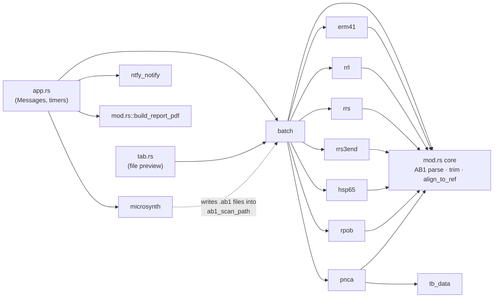
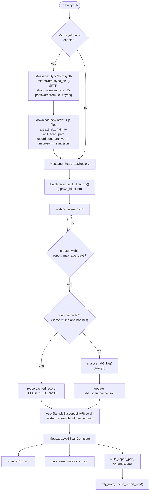
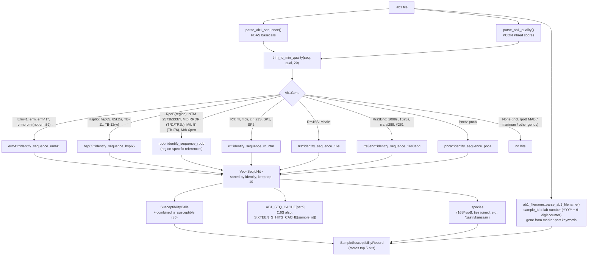
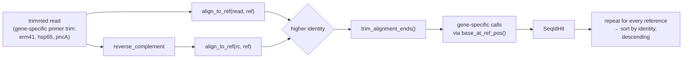
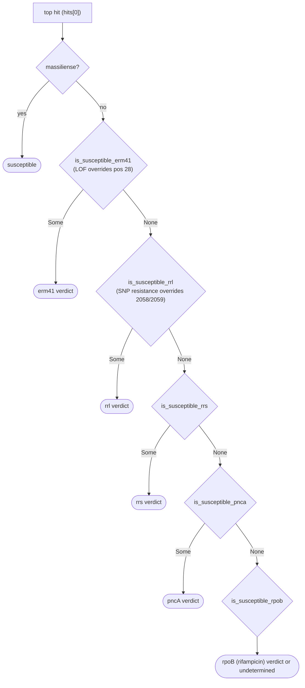
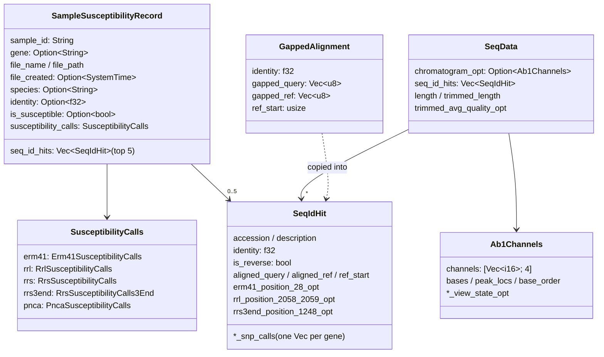

# `src/sequencing/` — how it works

This module turns Sanger capillary reads (`.ab1` chromatogram files) into two results:

1. **Species identification.** The closest mycobacterial reference, found by aligning the read
   against reference databases for one marker gene: 16S rRNA, hsp65, rpoB, 23S rRNA or erm(41).
2. **Resistance prediction.** Susceptible / resistant / undetermined calls for macrolides
   (erm(41), rrl), aminoglycosides (rrs), pyrazinamide (pncA) and rifampicin (rpoB, *M.
   tuberculosis* regions). Each call comes from reading
   specific diagnostic positions out of the alignment.

All reference sequences and mutation catalogues are compiled into the binary with
`include_str!`, so analysis needs no network access or external tools. The only networked parts
are the optional Microsynth download (`microsynth.rs`) and the ntfy push (`ntfy_notify.rs`).

---

## 1. Module map

| File | Role |
|---|---|
| [`mod.rs`](mod.rs) | Shared core: AB1 parsing (`parse_ab1_sequence`, `parse_ab1_quality`, `Ab1Channels::from_bytes`), quality trimming (`trim_to_min_quality`), primer trimming (`trim_start_end`), `reverse_complement`, alignment (`align_to_ref`, `trim_alignment_ends`, `base_at_ref_pos`), FASTA parsing, the embedded reference FASTAs, the key types (`SeqIdHit`, `SeqData`, `SusceptibilityCalls`), and the PDF report (`build_report_pdf`). |
| [`ab1_filename.rs`](ab1_filename.rs) | Filename parsing (`parse_ab1_filename`): lab number → `sample_id`, marker keywords → `Ab1Gene` (see §3). |
| [`batch.rs`](batch.rs) | Directory scanning (`scan_ab1_directory`), per-file pipeline (`analyse_ab1_file`), in-memory and on-disk caches, preview analysis (`analyse_ab1_for_preview`), CSV export (`write_ab1_csv`, `write_rare_mutations_csv`). |
| [`erm41.rs`](erm41.rs) | erm(41) for the *M. abscessus* complex: subspecies ID plus position 28 and loss-of-function (LOF) SNP calls, which predict inducible macrolide resistance. |
| [`rrl.rs`](rrl.rs) | 23S rRNA: species ID plus macrolide resistance at *E. coli* positions 2058/2059 and catalogue SNPs. |
| [`rrs.rs`](rrs.rs) | 16S rRNA: species ID plus aminoglycoside-resistance SNPs. |
| [`rrs3end.rs`](rrs3end.rs) | 16S rRNA 3′ end: position 1248 (*M. marinum* A vs *M. ulcerans* G) plus the same aminoglycoside SNP logic as `rrs.rs`. |
| [`hsp65.rs`](hsp65.rs) | hsp65/groEL2: species ID, primer trimming, kansasii/gastri and marinum/ulcerans diagnostic SNPs. |
| [`rpob.rs`](rpob.rs) | rpoB: species ID per region; for the Mtb regions also rifampicin resistance (RRDR) from the WHO catalogue. |
| [`pnca.rs`](pnca.rs) | pncA (*M. tuberculosis* complex): pyrazinamide resistance from the WHO catalogue. |
| [`tb_data.rs`](tb_data.rs) | TBProfiler `*.results.json` deserialization, `confidence_rank`, and the TB → *E. coli* coordinate map. |
| [`bed.rs`](bed.rs) | Parser for 5-column subspecies barcode BED files. |
| [`microsynth.rs`](microsynth.rs) | *(feature `russh`)* SFTP download of AB1 archives from Microsynth into the scan directory. |
| [`ntfy_notify.rs`](ntfy_notify.rs) | Sends the finished PDF report to an ntfy topic. |
| [`serde_helpers.rs`](serde_helpers.rs) | Serde adapters for the cache JSON (`BTreeMap<u8, _>`, `Option<SystemTime>`). |



---

## 2. End-to-end pipeline (periodic scan)

`app.rs` subscribes to a **2-hour timer** for each configured scan directory (`ab1_scan_path`
and, optionally, `ab1_scan_path_2`). When Microsynth sync is enabled, the timer for the first
path fires `SyncMicrosynth`, which downloads new files before the scan. If the download fails,
the scan still runs.



**Interactive preview.** When a user selects an AB1 file in the file manager, `tab.rs` first
looks for its hits in `AB1_SEQ_CACHE`. If the file is outside the scan directories, `tab.rs`
calls `analyse_ab1_for_preview()`, which runs the same per-file pipeline but uses its own disk
cache (`ab1_preview_cache.json`).

---

## 3. Per-file analysis (`batch::analyse_ab1_file`)



`parse_ab1_filename` ([`ab1_filename.rs`](ab1_filename.rs)) is the only place keywords are
matched; both the batch scan and the preview pane (`Item::is_*`) use it. It finds the lab number
(`YYYYNNNNNN`, or the older `YYYY_NNNNNN` / `NNNNNN-YY`, normalised to 10 digits) and then
matches keywords only in the marker part of the name: the lab number, `_Peaktraced` and the run
suffix (`_YYYY-MM-DD_hh-mm-ss_A01`) are removed first, so their digits never trigger a rule.
Rules are checked in the order shown, and the first match wins. A file selected as rpoB
follows the region rules of
[SANGER_RPOB.md](https://github.com/michaelmeuli/kansasii-docs/blob/master/docs/SANGER_RPOB.md)
and gets an `RpoBRegion`: the NTM species-ID region (2573f/3337r, or no primer token), or one
of the Mtb rifampicin regions: RRDR (TR1/TR2b, `81`, `core`, `mut`), 5′ region (Tb176) and
Xpert (rpoB-F1/F2/R2, `GeneXpert`). `identify_sequence_rpob` aligns each region only against
that region's references. MAB, marinum and other-genus rpoB reads have no references and get
no gene. Sources:
[SANGER_LABNUMBERS.md](https://github.com/michaelmeuli/kansasii-docs/blob/master/docs/SANGER_LABNUMBERS.md),
[PRIMERS.md](https://github.com/michaelmeuli/cosmic-seq/blob/master/docs/PRIMERS.md).

`analyse_ab1_file` picks the analysis from the `Ab1Gene` it returns, so the gene label and the
analysis always agree. A file that matches no keyword still gets a record, but with no hits,
species or calls. A disk-cached record whose gene differs from what the current parser
returns is re-analysed.

---

## 4. Alignment core

Every `identify_sequence_*` function follows the same pattern:



### `align_to_ref(query, reference) → GappedAlignment`

- Uses the rust-bio `pairwise::Aligner` in **semiglobal** mode. The whole read is placed inside
  the reference, and end gaps on the reference are free.
- Scoring: match **+1**, mismatch **−1**, gap open **−5**, gap extend **−1**. Comparison is
  case-insensitive.
- **Identity = matches ÷ reference span × 100.** Deletions in the read therefore lower the
  identity.
- Returns `gapped_query` and `gapped_ref` (same length, `-` marks gaps) and `ref_start`, the
  0-based position where the alignment starts on the reference.

### `trim_alignment_ends(ga)`

Removes junk from the ends of the read that quality trimming missed:

1. Strips columns where only the read has bases (pure insertions) from both edges, for example
   a read that runs past the amplicon into vector sequence.
2. Slides a **15-column window** inward from each edge. The first window with a match rate of
   at least **70 %** marks the trim point.
3. Recomputes `ref_start` and identity. The function never returns an alignment with lower
   identity than its input.

### `base_at_ref_pos`

Maps a reference coordinate to the read base aligned there. All SNP calls use it.
Positions outside the aligned region, or on a gap, give no call.

### Reportability threshold

`MIN_SEQ_ID_IDENTITY = 80.0`. The CSV and PDF outputs only include hits at or above this
identity.

---

## 5. Gene modules

Two kinds of call recur:

- **Anchor calls** find a fixed left and right flanking sequence (`*_ANCHOR_L` / `*_ANCHOR_R`
  in `mod.rs`) in the raw read and read the base or bases between them. If the forward read has
  no match, the reverse complement is tried.
- **Catalogue SNP calls** read every catalogued position through the alignment.

The `rrl`, `rrs` and `rrs3end` modules make catalogue calls only for ntm-db full-gene references,
whose accession contains `:`. This is because the catalogue coordinates refer to those
sequences. `best_snp_hit()` then finds the hit with SNP data among the hits that share the
top hit's species.

| Module | References | Diagnostic logic | Result |
|---|---|---|---|
| **erm41** | 3 subspecies FASTAs: *abscessus* ATCC 19977, *bolletii* CIP 108541, *massiliense* CCUG 48898 | Primer trim (`ERM41_FWD_START/END`) → anchor call at **position 28** (C/G/A = susceptible, **T28 = inducible resistance**) → LOF SNPs from ntm-db `Mycobacterium_abscessus/variants.csv`. **Any observed LOF allele overrides position 28 and gives susceptible.** *massiliense* is always susceptible, because its erm(41) is non-functional. | `Erm41Position28`, `Vec<Erm41LofCall>` |
| **rrl** | `myco_rrl.fasta` (≥ 1200 bp) | Anchor call at **2058/2059**: A/A = wildtype (susceptible), any other base = resistance → catalogue SNPs from ntm-db `variants.csv` (abscessus, avium, intracellulare). Any resistance allele gives resistant. A wildtype 2058/2059 combined with a resistance SNP elsewhere is reported as a **rare** mutation. | `RrlPosition2058_2059`, `Vec<RrlSnpCall>` |
| **rrs** | `myco_rrs.fasta` (≥ 1200 bp) | Aminoglycoside resistance SNPs (e.g. `n.1401A>G`) from ntm-db `variants.csv` | `Vec<RrsSnpCall>` |
| **rrs3end** | `myco_rrs.fasta` | Anchor call at **1248** (A = *M. marinum*, G = *M. ulcerans*) plus the same SNP logic as `rrs`, stored in `rrs_snp_calls_3end` | `Rrs3EndPosition1248`, `Vec<RrsSnpCall3End>` |
| **hsp65** | `myco_hsp65.fasta` | Trims Telenti and Patel primer sets. For kansasii/gastri hits: 8 diagnostic SNPs. For marinum/ulcerans hits: 5 diagnostic SNPs. A majority vote decides (`*_snp_species_call`). | `KansasiiGastriSnpCall`, `MarinumUlceransSnpCall` |
| **rpob** | NTM region: `myco_rpob.fasta` + `references/rpoB_2573f_3337r.fasta` (≥ 400 bp). Mtb regions: `references/rpoB_TR1_TR2b.fasta` (RRDR), `rpoB_Tb176f_Tb176r.fasta` (5′), `rpoB_Xpert_*.fasta` (Xpert), no length filter. Rifampicin calls: `rpob/rpob_h37rv.fasta` (H37Rv Rv0667 CDS) | Species ID; for the Mtb regions the read is also aligned to H37Rv and every RRDR codon (426–452), the catalogued codons outside it (V170F, I491F) and RRDR indels are called against the WHO catalogue | `Vec<RpobSnpCall>` (top hit only) |
| **pnca** | *M. tuberculosis* H37Rv, *M. bovis* AF2122/97, *M. canettii* CIPT 140010059 (CDS + 50 bp promoter) | Parses the WHO catalogue `tbprofiler/mutations.csv` into nucleotide maps (`c.-N` promoter / `c.N`) and codon maps (`p.Xxx123Yyy`), then calls every listed site. | `Vec<PncaSnpCall>` |

**pncA verdict (`is_susceptible_pnca`):**

- **Resistant** if any site carries a catalogued allele with confidence rank < 2
  ("Assoc w R" or "Assoc w R - Interim").
- **Susceptible** only if every site is covered and wildtype.
- Otherwise **undetermined**: a site is uncovered, a variant is not in the catalogue, or the
  evidence is weak.

Ranks come from `tb_data::confidence_rank`, on a scale from 0 (strongest) to 5.

**rpoB rifampicin verdict (`is_susceptible_rpob`):**

- **Resistant** if a catalogued alt at rank < 2 is seen (e.g. S450L, V170F, I491F), if any
  missense change hits an RRDR codon (catalogue rule `missense_variant_p.426_452`), or if there
  is an in-frame indel in the RRDR (c.1276–1356).
- **Susceptible** only if all 27 RRDR codons are covered and wildtype (synonymous changes
  allowed) and nothing unclear was seen.
- Otherwise **undetermined**: the RRDR isn't fully covered (e.g. a Tb176 5′-region read), a
  frameshift or stop codon (probable read error), or an uncatalogued change outside the RRDR.
- `RpobSusceptibilityCalls::species_validated` is `false` when the best species hit isn't
  *M. tuberculosis* (e.g. TR1/TR2b run on an NTM). The calls are still made but flagged in
  the preview, the CSV (`rpob_species_validated`) and the "Calls" column.

---

## 6. Combined susceptibility verdict

`SampleSusceptibilityRecord::is_susceptible` checks the genes in priority order. **The first
gene that gives a verdict (not `None`) decides.** Because each file holds one amplicon,
usually only one gene contributes.



Disk-cached records carry `analysis_version`. A record whose version differs from
`batch::ANALYSIS_VERSION` is re-analysed, so bump the constant when the calls change.

`SusceptibilityCalls` stores the full evidence for each gene, not only the verdict. The UI,
CSV and PDF show it (its `Display` output is the "Calls" column).

---

## 7. Key types



- `SampleSusceptibilityRecord` is the batch / report result, with one record per file.
- `SeqData` is the result for the interactive single-file view. It includes the raw traces
  (`Ab1Channels`) used to draw the chromatogram. The `Erm41ViewState`, `Rrs3EndViewState` and
  `RrlNtmViewState` fields let the view zoom to the diagnostic position.

---

## 8. Caches

| Cache | Key → value | Where | Purpose |
|---|---|---|---|
| `AB1_SEQ_CACHE` | canonical path → top 10 `SeqIdHit` | memory | The preview panel reads hits without aligning on the UI thread. |
| `SIXTEEN_S_HITS_CACHE` | sample_id → 16S hits | memory | Another file from the same sample can show its 16S species, even if the files are in different directories. |
| `ab1_scan_cache.json` / `ab1_scan_cache_2.json` | path → (mtime, record) | disk (`ab1_cache_path`, or the scan dir) | Rescanning unchanged files skips alignment. |
| `ab1_preview_cache.json` | path → (mtime, record) | disk | Same, for files opened outside the scan directories. |
| `.microsynth_sync.json` | archives already extracted | disk (scan dir) | Avoids downloading the same Microsynth archives again. |

---

## 9. Reference data

All files are embedded at compile time from `res/sequences/` (see the `REF_*` constants in
`mod.rs`):

- `myco_rrs.fasta`, `myco_rrl.fasta`, `myco_hsp65.fasta`, `myco_rpob.fasta`: pooled
  Mycobacteriaceae reference FASTAs. `build.rs` assembles them from NCBI fetches
  (`sequences.toml`), the `ntm-db` submodule and `kansasii-complex/`. The `mod.rs` header also
  describes how [cosmic-seq](https://github.com/michaelmeuli/cosmic-seq) generates amplicon
  references from GTDB r232 species-representative genomes using in-silico PCR with the lab's
  primer pairs.
- `erm41/*.fasta`, `pnca/*.fasta` and `rpob/rpob_h37rv.fasta`: per-subspecies or per-strain
  references (the last is the coordinate system for rifampicin calls).
  (`myco_erm41.fasta` is generated but not used.)
- Mutation catalogues: `ntm-db/db/<species>/variants.csv` (erm41, rrl, rrs) and
  `tbprofiler/mutations.csv` (pncA and rpoB, WHO catalogue).
- `res/tb_ecoli_mapping.csv`: TB → *E. coli* coordinates for display.

Lazily initialised `LazyLock` statics parse these files on first use: `RRS_REFS`, `RRL_REFS`,
`HSP65_REFS`, `RPOB_REFS`, `PNCA_RESISTANCE_SNPS` and others. `dedup_substring_same_desc` removes
any reference that is a substring of another reference with the same species name.

---

## 10. Tests

```bash
cargo test -p cosmic-files -- sequencing
```

The tests live inline in each module and cover alignment, trimming, anchor calls and
resistance verdicts.
